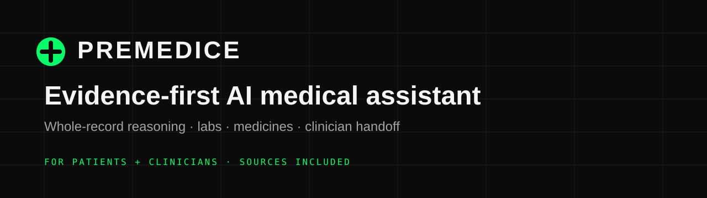

<div align="center">
  
</div>

<h1 align="center">Premedice</h1>

<p align="center">
  <strong>Evidence-first AI medical assistant for patients and doctors.</strong><br/>
  Reads labs, medicines, documents and health history together — then shows its sources.
</p>

<p align="center">
  <a href="https://premedice.com">Website</a> ·
  <a href="https://app.premedice.com">Open the app</a> ·
  <a href="https://premedice.com/doctors/">For clinicians</a> ·
  <a href="https://api.premedice.com">API</a> ·
  <a href="https://premedice.com/news/">Research</a>
</p>

<p align="center">
  
  
  
  
</p>

---

## Why Premedice?

Most health tools answer one question at a time. Premedice reads the **whole record**:

- lab results and trends,
- prescriptions and medication history,
- uploaded documents and reports,
- symptoms and observations,
- the patient's own questions.

Then it returns a plain-English answer with sources, keeps the record over time, and gives clinicians a workspace to review the same evidence.

That is the difference between a chat demo and a clinical workflow.

### Earlier warning tracking

The thing Premedice does best is track warning signals **earlier**. It follows labs, medications, symptoms and history over time and surfaces the small changes that are easy to miss in a short appointment.

Not because clinicians are careless — because a 10-minute visit cannot hold the whole record. Premedice keeps watching the record between visits and puts the signal in front of the patient and the clinician.

---

## What it does

| Capability | What you get |
|---|---|
| **Whole-record chat** | Ask about symptoms, labs, medicines or a report with the patient's own context |
| **Lab interpretation** | 50+ markers, reference-range checks, trends and plain-English explanations |
| **Medication safety** | Drug-interaction review, CPIC/ClinPGx pharmacogenomics, renal/hepatic calculators |
| **Rare disease** | HPO/Orphanet/MONDO phenotype matching with OMIM and Orphanet references |
| **Evidence** | Answers show their sources and call out uncertainty |
| **Clinician workspace** | Patient links, notes, access logs, SOAP notes, referrals and doctor-ready summaries |
| **Medicine cards** | Related options with class, cautions and tiny DailyMed label images |
| **API** | OpenAI-compatible medical reasoning API for builders and agents |

### Coverage

- 45+ live clinical sources and tools
- 76 active clinical skills
- 54 common lab markers with trends and reference checks
- Web app, API and MCP access

### Product surfaces

- **Patients and caregivers** — [app.premedice.com](https://app.premedice.com)
- **Clinicians** — [premedice.com/doctors](https://premedice.com/doctors/)
- **Developers** — [api.premedice.com](https://api.premedice.com)
- **Model page** — [Premedice 4](https://github.com/Pakakothaproject/premedice-4)

---

## Inside the workspace

<p align="center">
  
</p>

<p align="center">
  
</p>

---

## API

Premedice exposes an OpenAI-compatible endpoint for patient-education, lab-interpretation and clinical-reasoning products.

```bash
curl https://api.premedice.com/v1/chat/completions \
  -H "Authorization: Bearer pm_live_YOUR_KEY" \
  -H "Content-Type: application/json" \
  -d '{
    "model": "Premedice/Premed-4",
    "messages": [
      {"role": "user", "content": "Explain these lab results and flag what should be discussed with a clinician."}
    ]
  }'
```

See the API documentation at [api.premedice.com](https://api.premedice.com) and the [Premedice 4 API docs](https://github.com/Pakakothaproject/premedice-4/blob/main/docs/api.md).

---

## Documentation

- [What Premedice delivers](docs/results.md)
- [Premedice 4 benchmark comparison](https://github.com/Pakakothaproject/premedice-4/blob/main/docs/comparison.md)
- [Lab Memory](docs/lab-memory.md)
- [Trust and Safety](docs/trust-and-safety.md)
- [API and MCP](docs/api-and-mcp.md)
- [Security policy](SECURITY.md)
- [Changelog](CHANGELOG.md)

---

## Safety boundaries

- Premedice is decision support, not a diagnosis.
- It does not replace a licensed clinician.
- Emergency symptoms require local emergency services.

Clinical decisions belong with a qualified clinician who knows the patient's history.

---

## License

MIT for this documentation repository. The Premedice name, logo and product marks remain the property of Diagnostics AI, Inc.

See [LICENSE](LICENSE).
