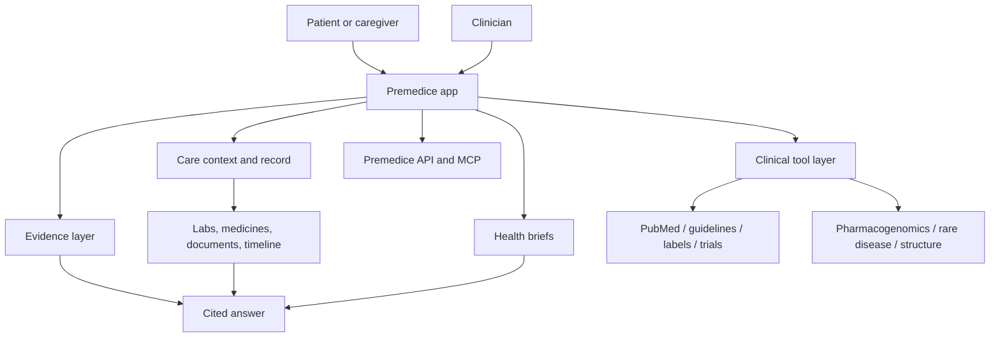

# Premedice — Architecture

**Status:** Beta
**Last updated:** 3 November 2026

---

## Product layers

## Core concepts

### Care contexts

Every record is scoped to a care context: the account owner or a cared-for person. Conversations, documents, observations, labs, and briefs carry a context ID. One context must never leak into another.

### Whole-record context

The assistant receives the active subject's structured record: profile, conditions, medicines, allergies, labs, documents, timeline, and notes. The record is injected only when the subject is explicitly selected.

### Clinical tool layer

The assistant routes to live sources rather than relying only on model memory. Tool results are treated as data, not instructions.

### Evidence layer

Sources are captured, shown with citations, and checked after the answer is drafted. This is a safety aid, not a guarantee.

### Doctor sharing

Patients invite a doctor by email, choose scope, and can revoke access. Doctor reads are logged. Signed clinical review is being expanded.

### Health briefs

A periodic brief summarizes what changed, what to watch, one question for the doctor, and the next step. It uses labs, medicines, symptoms, and timeline — not wearables.

## Design principles

1. Scoped records over global access.
2. Retrieval over memory.
3. Citations over confidence.
4. Explicit uncertainty over invented certainty.
5. Human review over autonomous action.
6. No PHI in logs.
7. No foundation-model claim.
